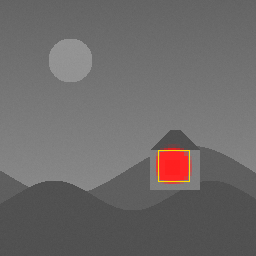

# image_version_control
A version control system similar to git for images.

## Build

Requires CMake (3.14+) and a C++17 compiler. On Ubuntu/Debian:
`sudo apt install cmake g++`.

```bash
cmake -S . -B build        # configure (once, creates build/)
cmake --build build        # compile
ctest --test-dir build --output-on-failure   # run the tests
```

## Version control: `ivc`

`ivc` works like git, on a folder of images. Add `build/` to your `PATH`
(or call `./build/ivc`):

```bash
cd my-photos
ivc init                                  # create the repository (.ivc/)
ivc add .                                 # stage every image in the folder
ivc commit -m "First version"

# ...edit photo.png in any editor...
ivc status                                # modified  photo.png
ivc diff photo.png -o diff.png            # what changed, and where
ivc add photo.png
ivc commit -m "Rotate" --op "rotate degrees=90" --tool "GIMP 2.10.36"

ivc log                                   # history, newest first
ivc show HEAD~1                           # one commit in full
ivc verify                                # check the whole history

ivc checkout HEAD~1                       # go back to the previous version
ivc checkout main                         # and forward again
ivc checkout -b black-white               # start a branch from here
ivc branch                                # list branches
ivc restore photo.png --from HEAD~2       # bring back one file
```

`ivc help` lists every command. A revision is a branch name, a commit ID or
its first 4+ characters, `HEAD` (the current commit), or `<revision>~<n>`
for *n* commits back.

## Declared edits, verified against the pixels

An editor (or you) can declare **which operations** produced each new version.
`ivc` records them in the commit and **checks them against the pixels**:

```bash
ivc commit -m "Rotate" --op "rotate degrees=90" --tool "GIMP 2.10.36"
ivc commit -m "Retouch" --op "drawing region=160,76,16,16"
ivc commit -m "Editor session" --ops-file edits.ops   # one operation per line
ivc operations                                        # the known operations
```

An operation is an action plus `key=value` parameters; add `file=<path>` when
more than one image changed, and `region=x,y,width,height` to say where it
acted. Action names map to [C2PA](https://c2pa.org) actions where one exists
(`rotate` → `c2pa.orientation`, `crop` → `c2pa.cropped`, ...), including
`ai_edit` and `ai_generate` for generative AI. Each operation gets an ID: the
SHA-256 of its file, action, parameters and tool.

Each changed image gets one of these results:

| Result | Meaning |
|---|---|
| **VERIFIED** | `ivc` replayed the operations itself and got exactly the committed pixels |
| **CONSISTENT** | same as the replay, apart from invisible differences (another program's rounding, JPEG) |
| **DECLARED** | changes `ivc` cannot replay (filters, brushes, AI), all inside the regions they declared |
| **MISMATCH** | the image does **not** match what was declared: undeclared regions are listed |
| **UNDECLARED** | the image changed but nothing was declared |

Replayable today: `rotate`, `flip`, `crop`, `resize`, `brightness`,
`grayscale`. The check uses the SSIM difference *without* searching for
rotations, so an undeclared rotation cannot hide.

What this can and cannot do: an editor that declares nothing leaves only
UNDECLARED changes, and a filter declared without a region covers the whole
image. Claims are checked, not trusted: a false claim is a MISMATCH even if
the commit is signed.

## Signed commits and `ivc verify`

```bash
ivc key generate "Javi"          # once: your Ed25519 key, in ~/.config/ivc
ivc trust --me                   # in each repository: trust your own key
ivc trust <public-key> "Name"    # trust someone else's
ivc verify                       # check the history
ivc verify --strict              # also fail unsigned or untrusted commits
```

With a key, every commit is signed automatically (`--no-sign` to skip). The
signature covers every byte of the commit except the signature line itself,
including the declared operations and their check results. Signatures use
[Monocypher](https://monocypher.org) (`third_party/monocypher`, audited,
public domain), checked against the RFC 8032 test vectors; the signature
algorithm is deliberately not home-made.

`ivc verify` walks the history and reports, per commit:

- the commit was **not altered** (its ID is the SHA-256 of its text);
- the **signature** is valid, and whether the key is trusted here;
- every **stored file** still matches its file ID and image ID;
- every **declared operation** record matches its ID, and the operations are
  **re-checked against the pixels** (MISMATCH is a problem).

It exits with status 1 when there is a problem. A signature proves *who*
made a commit and that it was not changed; it does not prove the edits are
true. That is what the pixel checks are for. Someone rewriting history could
drop the signatures entirely, so use `--strict` when every commit is
expected to be signed.

## What is stored

Everything lives in `.ivc/` at the root of the folder:

| Path | Content |
|---|---|
| `HEAD` | `ref: refs/heads/<branch>`, or a commit ID when looking at an older version |
| `refs/heads/<branch>` | the latest commit of each branch |
| `index` | the staging area: the files the next commit will contain |
| `objects/files/<id>` | the original bytes of every version of every file, named by their SHA-256 |
| `objects/commits/<id>` | the commits, as text, named by the SHA-256 of that text |
| `trusted_keys` | public keys whose signatures this repository trusts |

Each file version has two IDs: the **file ID** (SHA-256 of its bytes), used
to restore it exactly, and the **image ID** (SHA-256 of its pixels), its
identity whatever the format or metadata. A commit is a readable text file:

```
ivc-commit 1
parent 3e71d236e64e4fe3971cab55e4ab24dd21f4700e7e5186da5373023e6f4744be
author Javi
date 2026-10-15T22:17:33Z
signer 6bf637d396b5479e51cb782879cbe1ba164025e3c8ebb52718ebe6da38c59465 Javi
op photo.png
  action rotate
  params degrees=90
  tool GIMP 2.10.36
  c2pa c2pa.orientation
  id eeae8e6c5a8afcfe57f763782a4b7e32db8e7d4aaa592e958bfa508d770694df
file 5c35b27d…dd89b54891 c6fdc93b…6c343a1a5d photo.png
change modified photo.png
  similarity 1.000
  detected rotated 90
  pixels 0 changed
  visible 0 region(s)
  check VERIFIED replaying 1 operation(s) reproduces the image exactly
signature 1beb9420…10c5cbe0b

Rotate
```

- `signer` / `signature`: who signed, and the Ed25519 signature of everything
  else.
- `op <path>`: a declared operation, with its C2PA action and ID.
- `file <image id> <file id> <path>`: every file in this version.
- `change <kind> <path>`: what happened (`added`, `modified`, `replaced`,
  `metadata`, `deleted`); the indented lines are what the comparison measured,
  and `check` is the result of the declared operations against the pixels.

Unknown lines are ignored, so new fields can be added later without breaking
old repositories.

Not yet: merging branches, storing only the changed parts of an image (each
version currently stores the full file), and import/export of C2PA manifests.

## Inspection tools

```bash
# Pixel values of an image (summary, or every pixel as "x y R G B A")
./build/ivc_pixels samples/00_original.png
./build/ivc_pixels samples/00_original.png --dump > pixels.txt

# Exact hash of each image's pixels
./build/ivc_hash samples/*.png samples/*.jpg

# Is each image a version of the reference? Similarity, verdict, orientation
./build/ivc_compare samples/00_original.png samples/*.png samples/*.jpg

# Where two versions differ: IDs, exact and visible changes, difference image
./build/ivc_diff samples/00_original.png samples/03_small_region_edit.png -o diff.png
```



*`ivc_diff` on `03_small_region_edit.png`: the painted-over window is the
only change, outlined in yellow.*

## Image ID

Every image is identified by the **SHA-256 of its decoded pixels**
(`exact_hash`). Same pixels → same ID, whatever the file format,
compression or metadata.

## Differences: SSIM

`diff_images` (`src/diff.hpp`) shows *where* two versions differ:

1. **Align**: find the orientation with `compare_images` and turn the image
   back; if the sizes differ, compare at the smaller one.
2. **Exact differences**: with equal sizes, every pixel is compared, so even a
   single changed value is counted and located.
3. **Visible differences**: SSIM (structural similarity, `src/ssim.hpp`), which
   compares local brightness, contrast and structure around every pixel. It is
   built from Gaussian convolutions (`src/convolution.hpp`) and matches
   scikit-image to about 0.001. It is computed at two scales and the worse
   value kept at each point:
   - brightness at ½ size: changes of shape, texture or brightness;
   - each colour channel at ¼ size: changes of colour.

   At these scales pixel noise (JPEG artifacts, sensor noise) disappears while
   real edits remain: on the samples, JPEG stays above SSIM 0.84 everywhere
   while the window edit drops to −0.01. Points below 0.6 are grouped into
   changed regions.

Known limitation: crops and arbitrary rotations are recognised as versions,
but their difference map lights up because the content is shifted; they
need an alignment step (phase correlation / Fourier–Mellin), not
implemented yet.

## How images are compared

Two tools, each doing one job:

- **SHA-256 → identity** (`src/image_hash.hpp`, SHA-256 implemented from
  scratch in `src/sha256.cpp`): hashes a version tag, the width, height and
  channel count, and the decoded RGBA pixels. Identical pixels give the same
  ID whatever the file format or metadata; changing a single pixel value
  gives a completely different ID.
- **SSIM → similarity and differences** (`src/ssim.hpp`):
  - *Is it a version?* `compare_images` (`src/compare.hpp`) compares 32×32
    grayscale thumbnails with SSIM, trying the image in all 8 rotations by
    90° and mirrorings (`src/orientation.hpp`) and keeping the best.
    Similarity ≥ 0.70 means SIMILAR. On the samples, every edit scores
    ≥ 0.85 and the unrelated image ≤ 0.52.
  - *Where does it differ?* `diff_images`, described above.

All of these are pure functions (image in, result out, no state); `ivc`
(`src/repository.hpp`) is a separate layer that calls them.

Test images and their expected results are in [`samples/`](samples/README.md).
